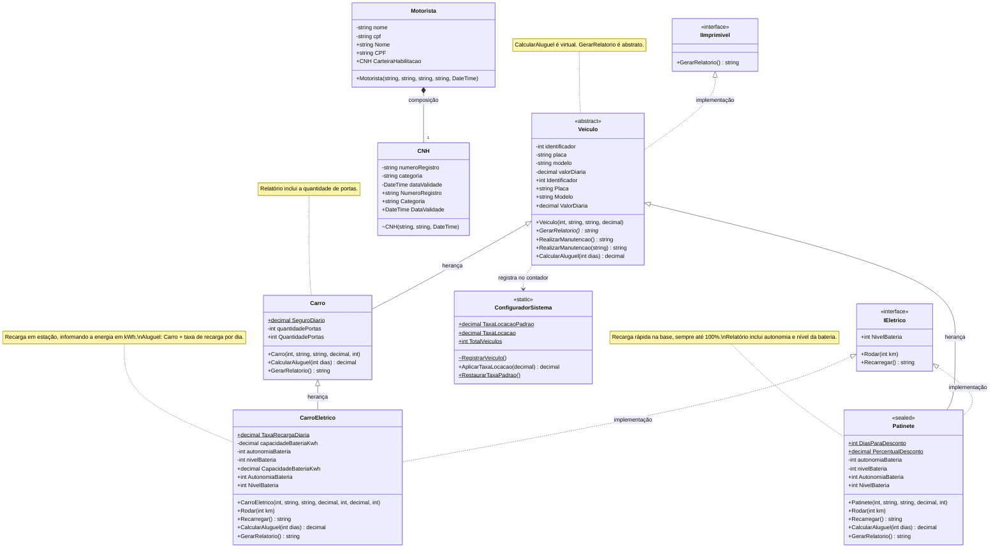

# Diagrama de Classes — UrbanDrive

## Legenda dos relacionamentos

| Relacionamento | Entre | Significado no código |
|---|---|---|
| Implementação | `Veiculo` → `IImprimivel` | `Veiculo` implementa a interface e declara `GerarRelatorio()` como abstrato. |
| Implementação | `Patinete` e `CarroEletrico` → `IEletrico` | Os dois implementam `NivelBateria`, `Rodar(int km)` e `Recarregar()`, cada um do seu jeito. |
| Herança | `CarroEletrico` → `Carro` | Reaproveita portas e seguro; soma a taxa de recarga ao aluguel e acrescenta os dados da bateria ao relatório. |
| Herança | `Carro` e `Patinete` → `Veiculo` | As classes concretas herdam os atributos e comportamentos comuns e implementam o relatório. |
| Composição | `Motorista` ◆— `CNH` | A `CNH` é criada dentro do construtor de `Motorista`. |
| Dependência | `Veiculo` ⇢ `ConfiguradorSistema` | O construtor de `Veiculo` registra a criação no contador. |