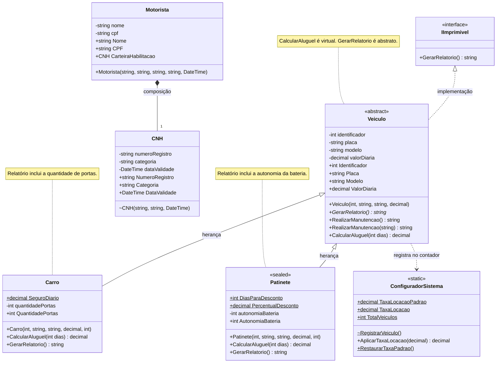

# Diagrama de Classes — UrbanDrive (após a parte de abstração e relatórios da Sprint 4)

> Para visualizar: abra este arquivo no GitHub (renderiza Mermaid automaticamente) ou cole o bloco em https://mermaid.live.
> Este diagrama registra a alteração de `Veiculo` para classe abstrata e a inclusão de `IImprimivel`.

## Legenda dos relacionamentos

| Relacionamento | Entre | Significado no código |
|---|---|---|
| Implementação | `Veiculo` → `IImprimivel` | `Veiculo` implementa a interface e declara `GerarRelatorio()` como abstrato. |
| Herança | `Carro` e `Patinete` → `Veiculo` | As classes concretas herdam os atributos e comportamentos comuns e implementam o relatório. |
| Composição | `Motorista` ◆— `CNH` | A `CNH` é criada dentro do construtor de `Motorista`. |
| Dependência | `Veiculo` ⇢ `ConfiguradorSistema` | O construtor de `Veiculo` registra a criação no contador. |

## Pendências do diagrama

- `Frota` ainda não está representada porque não existe no código desta versão.
- Não há relacionamento entre `Motorista` e `Veiculo` no código atual.
- A `TaxaLocacao` do `ConfiguradorSistema` ainda não é usada por `CalcularAluguel`.
