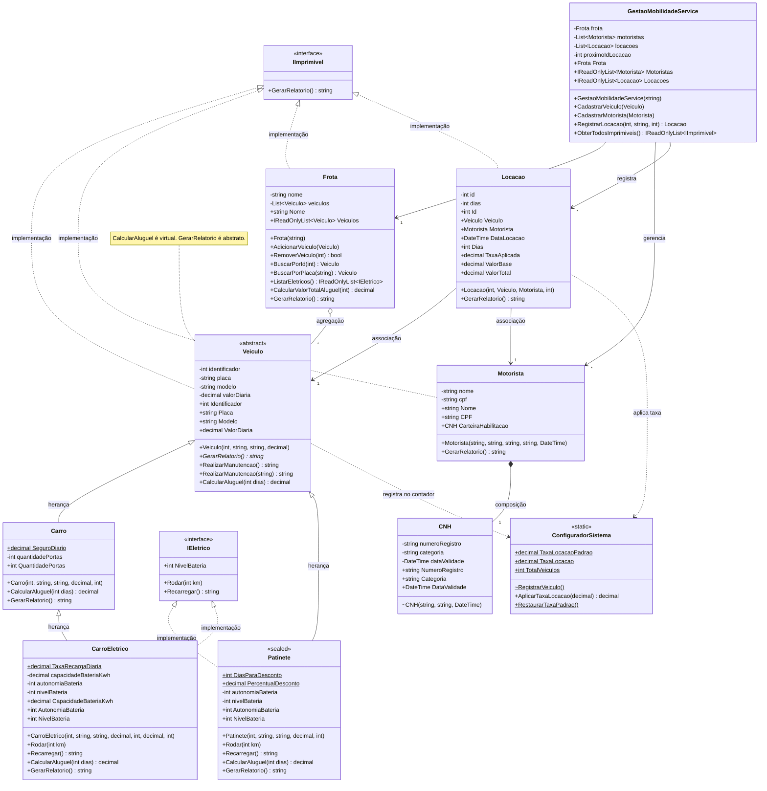

# Diagrama de Classes — UrbanDrive (Versão Final)

## Legenda dos relacionamentos

| Relacionamento | Entre | Significado no código |
|---|---|---|
| Implementação | `Veiculo`, `Motorista`, `Frota`, `Locacao` → `IImprimivel` | Todas as entidades principais implementam `GerarRelatorio()`. |
| Implementação | `Patinete` e `CarroEletrico` → `IEletrico` | Implementam `NivelBateria`, `Rodar(int km)` e `Recarregar()`. |
| Herança | `CarroEletrico` → `Carro` → `Veiculo` | Especialização em dois níveis com reaproveitamento de atributos e regras. |
| Herança | `Patinete` (`sealed`) → `Veiculo` | Classe selada que impede subtipos e aplica desconto a partir de 3 dias. |
| Composição | `Motorista` ◆— `CNH` | A `CNH` tem construtor `internal` e só existe criada dentro do construtor de `Motorista`. |
| Agregação | `Frota` ◇— `Veiculo` | A frota agrupa veículos existentes sem destruir seu ciclo de vida independente. |
| Associação | `Locacao` → `Veiculo` e `Motorista` | Registra o aluguel vinculando um veículo a um motorista com CNH válida. |
| Dependência | `Veiculo` e `Locacao` ⇢ `ConfiguradorSistema` | Contador global de veículos e aplicação compartilhada da taxa de locação. |
| Serviço | `GestaoMobilidadeService` → domínio | Coordena operações de cadastro, locação e consolidação de relatórios fora de `Program.cs`. |
