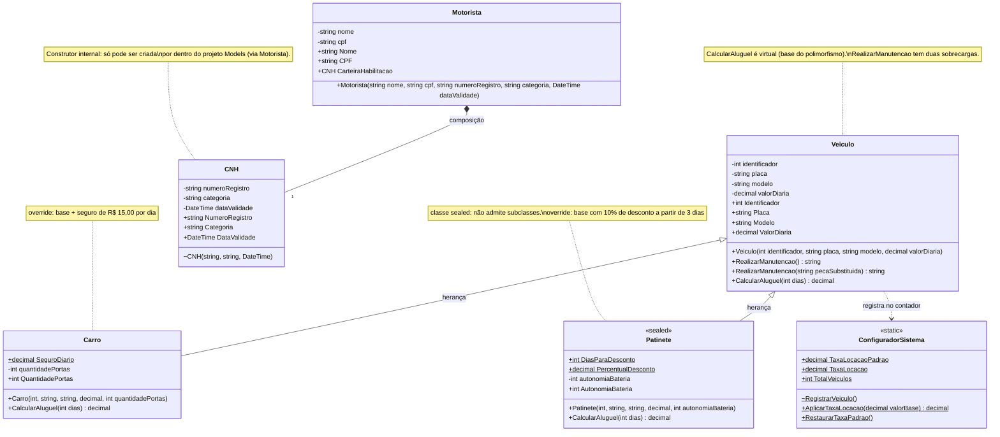

# Diagrama de Classes — UrbanDrive (estado após a Sprint 3)

> Para visualizar: abra este arquivo no GitHub (renderiza Mermaid automaticamente) ou cole o bloco em https://mermaid.live.
> Reflete somente o que existe hoje no código. Classes das próximas sprints (Frota, CarroEletrico, interfaces) devem ser adicionadas quando forem integradas.

## Legenda dos relacionamentos

| Relacionamento | Entre | Significado no código |
|---|---|---|
| Herança | `Carro` → `Veiculo`, `Patinete` → `Veiculo` | `: base(...)` no construtor e `override` em `CalcularAluguel`, que chama `base.CalcularAluguel` |
| Composição | `Motorista` ◆— `CNH` | A `CNH` é criada dentro do construtor de `Motorista`; não existe sem ele |
| Dependência | `Veiculo` ⇢ `ConfiguradorSistema` | O construtor de `Veiculo` chama `RegistrarVeiculo()` após validar os dados |

## Pendências do diagrama
- `Frota` (agregação com `Veiculo`) ainda não está na main. Adicionar quando for integrada.
- Não há relacionamento entre `Motorista` e `Veiculo` no código atual.
- A `TaxaLocacao` do `ConfiguradorSistema` ainda não é usada por `CalcularAluguel`.
